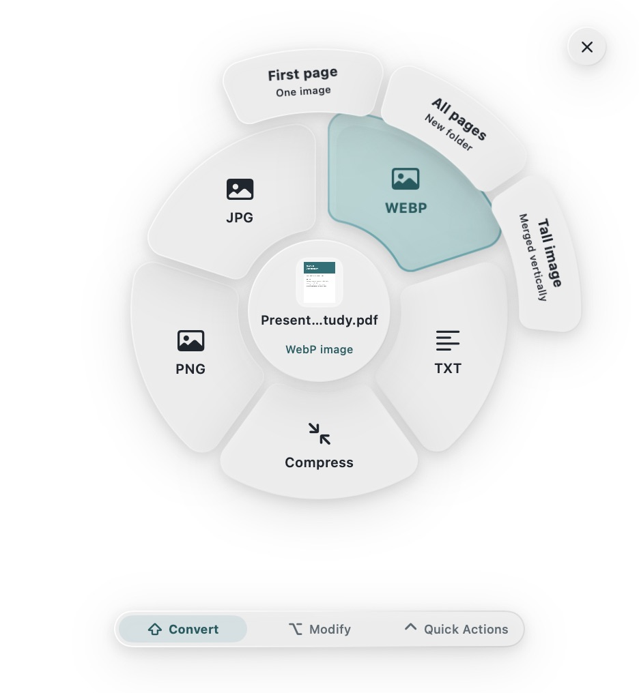
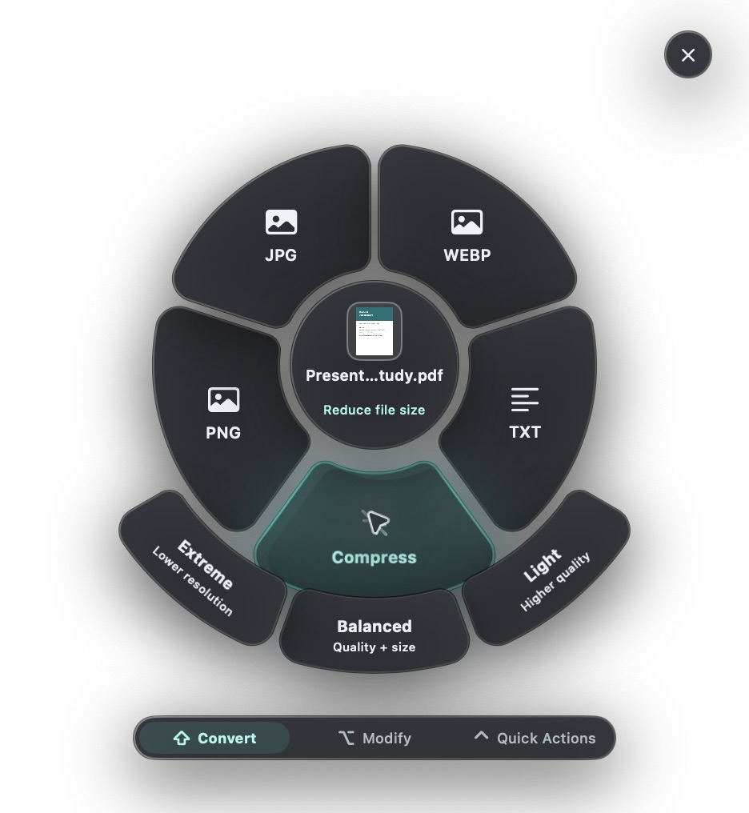

> Development branch: the new 0.4 local preview is documented in [Commercial Preview](docs/COMMERCIAL_PREVIEW.md). The published download remains 0.3 until the new preview is approved and release gates pass.

# FileOrbit

**Select a file. Tap ⌘ twice. Convert it.**

> **0.3 optical glass preview:** a compact native wheel with contextual presets, PDF tools, a batch shelf and Studio customization. This remains a preview release; see the verification record for tested configurations and remaining limits.

FileOrbit is a native macOS menu-bar app that brings a glass conversion wheel to the file you selected in Finder. Convert images, PDFs and documents, or make a smaller copy—all on your Mac, without uploading the file or opening another file picker.

<p>
  
  
</p>

Screenshots show the 0.3 optical glass interface in Light and Dark appearances.

[Download the Apple Silicon preview](https://github.com/nikhilsainethi/FileOrbit/releases/download/v0.3.0-preview.1/FileOrbit-macOS-arm64.zip) · [Installation guide](docs/INSTALL.md) · [Release notes](https://github.com/nikhilsainethi/FileOrbit/releases/tag/v0.3.0-preview.1)

> **Preview release:** the download is ad hoc signed, but it is **not Developer ID signed or notarized by Apple**. macOS may block its first launch. Read the [first-launch instructions](docs/INSTALL.md#first-launch-and-macos-security) before installing. The binary is for Apple Silicon; macOS 15+ is the deployment target, and macOS 27.2 on Apple Silicon is the locally tested configuration. Older macOS versions and Intel builds still need verification.

## Get started

1. Download and unzip `FileOrbit-macOS-arm64.zip`, then move **FileOrbit.app** to **Applications**.
2. Open FileOrbit. In its Settings, enable the Finder shortcut in **System Settings → Privacy & Security → Accessibility**. On the tested macOS 27 build, this pane is called **Device Control and Data Access**.
3. In Finder, select one file. Press and release the same **⌘ key twice quickly**. Allow FileOrbit to control Finder when macOS asks; this lets it read your selection.
4. Choose a format or **Compress** from the wheel. The result is saved beside the original, with a new name.

For DOCX, PPTX and TXT **conversion**, install [LibreOffice](https://www.libreoffice.org/download/) separately. Images, PDF tools, SVG rendering and DOCX image compression work without LibreOffice. The app download bundles qpdf, resvg and cwebp; there is no need to install them separately.

See the [installation guide](docs/INSTALL.md) for permissions, troubleshooting, updates and uninstalling.

## What it does

- **Works where your files are.** Double-tap Command in Finder to open actions for the current selection.
- **Runs locally.** No conversion servers, accounts, subscriptions or telemetry.
- **Keeps originals intact.** Existing files are never overwritten; compression saves a copy only when it is smaller.
- **Fits macOS.** Frameless floating petals, a compact file hub, keyboard navigation and native backdrop glass, precise annular sectors, and adaptive Light/Dark materials on macOS 15+. Choose System, Light or Dark appearance in Settings.
- **Shows available actions.** Formats depend on the selected file, macOS encoders and installed local converters.

| Input | Convert to | Compress |
| --- | --- | --- |
| Single-frame images readable by macOS | PNG, JPEG, HEIC, TIFF, WebP, PDF¹ | JPEG, PNG, HEIC and TIFF |
| PDF | PNG/JPEG/WebP (first page, all pages, or tall image); existing text layer to TXT | Structure optimization; optional eligible-image recompression |
| DOCX | PDF, TXT² | Embedded JPEG/PNG optimization |
| PPTX | PDF, PNG/JPEG per slide² | — |
| TXT | PDF, DOCX² | — |
| Static, self-contained SVG | PNG, JPEG, WebP | — |

¹ Image outputs depend on encoders available on your Mac. Same-format conversions are omitted. Animated and multipage images are not supported.

² Requires local LibreOffice. Complex Office layouts and fonts can render differently from Microsoft Office.

## Using the wheel

Click an action, or use the arrow keys and press **Return**. **Escape** first closes preset arcs, then the idle wheel. Hover for 160 ms over Compress or a multipage PDF image format to reveal outer preset arcs. Light, Balanced and Extreme are quality settings; actual compression savings depend on the file.

The legend switches between **⇧ Convert**, **⌥ Modify**, and **⌃ Quick Actions**. During a Finder file drag, those modifier keys reveal/switch the wheel in the production app. Drop onto an action or preset to run it, or onto the center to collect files in **Glass Shelf**. The isolated preview accepts drops onto its open wheel but intentionally does not register global shortcuts or drag monitoring.

Modify includes local Vision OCR, metadata removal, PDF splitting, and region-based PDF redaction, where supported. Redaction rebuilds **every page** as pixels with marked regions burned out; it removes searchable text, vectors, links, forms, attachments and source metadata. Always inspect the resulting copy. Metadata removal is narrower: PDF document Info and document-level XMP are removed; embedded objects, annotations and attachments are preserved. Image metadata removal saves a lossless PNG copy. These operations are distinct.

Quick Actions opens the shelf, the native AirDrop recipient chooser, copies the path, or opens the containing folder in Terminal. The menu-bar **Studio** offers radial action reordering, appearance previews and local history. History is session-only unless you opt into remembering it.

New files use `-converted` or `-compressed` names beside the source. Name collisions receive a unique name. Multipage image exports are placed in a new folder. A floating activity pill shows real sizes, Quick Look (Space), copy output files, Reveal in Finder and Undo. Undo moves only unchanged generated files to Trash; the original stays intact. The batch shelf reports each file’s outcome and supports cancellation.

Settings and **Choose File…** are available from the menu-bar icon. FileOrbit also supports drag-and-drop, **Choose a file**, and Finder’s **Open With** menu. These are optional entry points and work without shortcut permissions. Launch at login is optional and off by default.

## Current limits

Editable PDF-to-Office conversion, vector tracing, animated/multipage image conversion and password entry are not included. Standard TXT export reads an existing PDF text layer; use Modify → OCR for scanned PDFs. Batch jobs require a shared destination format or compression support across all selected files.

Compression can resize or recompress images, including images inside DOCX; it is not always lossless. PDF’s Gentle preset optimizes structure without lossy image conversion. Metadata can change, and transparent images get a white background when converted to JPEG.

Encrypted/locked PDFs and PDFs with signature fields cannot be modified. Signed DOCX compression, Office macros/embedded objects/linked resources, and SVG scripts/animation/external resources are rejected. Ordinary Office hyperlinks remain allowed.

Inputs and exports have resource limits to keep work bounded: general input 1 GB, Office input 256 MB, TXT 32 MB, and expanded Office packages 512 MB. PDF image export is capped at 144 DPI, 8,192 pixels per side and 32 megapixels per page; merged images have their own total pixel/height limit, and WebP is limited to 16,383 pixels per side; SVG output is capped at 2,048 pixels per side. Errors explain unsupported cases.

## Build from source

You need a Mac, Git, and Xcode or Command Line Tools with **Swift 6.2+ and the macOS 26 SDK or later**.

```sh
git clone https://github.com/nikhilsainethi/FileOrbit.git
cd FileOrbit

# If you use Homebrew: install qpdf, resvg, WebP and LibreOffice for integration tests.
./scripts/install-dependencies.sh
./scripts/test.sh

# Fetch qpdf/resvg and build a minimal checksum-pinned cwebp helper.
./scripts/fetch-helpers.sh
./scripts/build-app.sh
```

The build produces `dist/FileOrbit.app` and an architecture-specific ZIP. Extract the ZIP and move the app to Applications before granting permissions. This also avoids Finder metadata that synced folders can attach to loose app bundles. Building signs the app ad hoc; it does not notarize it.

Without Homebrew, install LibreOffice from its official site, run `fetch-helpers.sh`, and supply the fetched engines when testing:

```sh
FILEORBIT_QPDF="$PWD/.build/vendor/qpdf/bin/qpdf" \
FILEORBIT_RESVG="$PWD/.build/vendor/resvg/resvg" \
FILEORBIT_CWEBP="$PWD/.build/vendor/cwebp/cwebp" \
./scripts/test.sh
```

The helper download script has arm64 and x86_64 targets, but this release only provides a tested arm64 binary. See the [verification record](docs/TESTING.md) for exact local coverage and remaining platform checks.

### Command-line use

The CLI shares the app’s conversion engine:

```sh
swift run fileorbit-cli --engines
swift run fileorbit-cli --capabilities /absolute/path/photo.png
swift run fileorbit-cli /absolute/path/photo.png --to jpg
swift run fileorbit-cli /absolute/path/report.pdf --compress balanced
swift run fileorbit-cli /absolute/path/slides.pptx --to png --output-dir /existing/output/folder
```

It returns JSON and a nonzero exit status on errors. Use `FILEORBIT_SOFFICE`, `FILEORBIT_QPDF`, `FILEORBIT_RESVG` and `FILEORBIT_CWEBP` to override converter paths. GUI Settings can also locate installed engines.

### Isolated optical preview

```sh
./scripts/fetch-helpers.sh
./scripts/build-preview.sh /tmp/FileOrbit-optical-preview
```

Open `/tmp/FileOrbit-optical-preview/FileOrbit Preview.app`. It uses a separate bundle ID and preferences, does not install into Applications, and leaves the production shortcut alone. See [preview behavior and checks](docs/OPTICAL_PREVIEW.md).

For Xcode’s canvas, enable `FILEORBIT_XCODE_PREVIEWS` under **Active Compilation Conditions**. The Light/Dark `#Preview` scenes generate a local PDF fixture and show the actual wheel, hub and parameter arcs. The normal SwiftPM build does not require Xcode’s preview macro plugin.

## Development and contributing

The project uses Swift Package Manager:

- `FileOrbitCore` contains capability discovery, converters, process supervision, output publication and the gesture recognizer.
- `FileOrbit` contains the AppKit menu bar/panel, SwiftUI wheel, Settings and Finder integration.
- `FileOrbitCLI` exposes the conversion engine from Terminal.
- `Tests` covers file integrity, formats, cancellation, subprocesses, gesture recognition and state regressions.

Bug reports and pull requests are welcome. When [reporting an issue](https://github.com/nikhilsainethi/FileOrbit/issues), include your macOS version, chip, source format, action and exact error. Use a small, non-sensitive sample if one is needed. Read [Contributing](CONTRIBUTING.md) before submitting changes and [Security](SECURITY.md) for vulnerability reporting. The [installation guide](docs/INSTALL.md#shortcut-diagnostics) explains opt-in shortcut diagnostics.

## License

FileOrbit is available under the [MIT License](LICENSE). Bundled third-party components retain their own licenses; see [Third-party notices](THIRD_PARTY_NOTICES.md).
