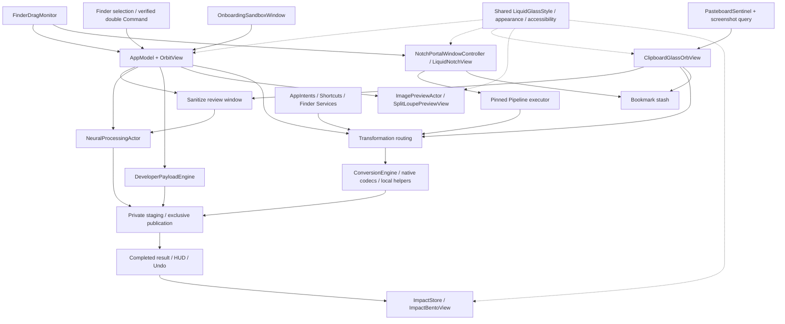

# FileOrbit Commercial Feature & Systems Blueprint

Status: approved commission translated into implementation contracts; isolated development preview. This document is a design and acceptance plan, not a claim that every feature has passed verification.

## Product promise

A selected file, a spatial gesture, and a local transformation. No uploads, accounts, cloud inference, document-content telemetry, or replacement of the user's original. Keep double-tap Command, Shift/Option/Control Finder drags, the existing radial geometry, Shelf, Undo, and native appearance behavior intact. New surfaces use the same optical material and action routing.

The user approved editable detection boxes before Sanitize exports. AI suggestions must never export silently. Existing installed 0.3.0 and public GitHub remain unchanged until this preview is reviewed.

## Architecture and alternatives

Use independent, bounded processing actors plus main-actor UI coordinators. This fits the existing SwiftPM AppKit/SwiftUI app, allows deterministic tests without windows, and avoids letting clipboard observation own conversion state. A single all-purpose AppModel would couple observers and processing unnecessarily. Separate executable services would add signing, IPC, and deployment work without a current requirement. The chosen modular in-process approach keeps those future options open.

Swift 6 language mode and complete concurrency checking apply to all targets. AppKit objects and pasteboards remain on MainActor; actors transfer value snapshots, URLs, encoded Data, and Sendable results. No broad unchecked-Sendable suppression or unsafe global state. Existing lock-protected cancellation retains its documented narrow exception.

## 1. Neural processing

`NeuralProcessingActor` owns each Vision request, CIContext, image decoding and rasterization. No model downloads or network fallback. Apple Vision supplies the local model; importing CoreML does not imply a custom model or guarantee Neural Engine placement.

**Lift Subject** operates on bounded, oriented single-frame images, rejects animated/multipage images, and calls `VNGenerateForegroundInstanceMaskRequest`. It uses all detected foreground instances and produces PNG. Transparent, copy sticker, and opaque white backdrop are three explicit outputs. No detected subject is a useful error, never a fabricated result. Copy Sticker writes PNG to the pasteboard after a successful result. Shimmer runs only while segmentation is in progress; Reduce Motion uses a static indicator. Cancellation and a changed source invalidate pending results.

**Sanitize** renders images and every PDF page, uses `VNRecognizeTextRequest`, and maps detected token ranges back to normalized displayed-page rectangles. Match emails, plausible phones, postal addresses, validated card numbers (Luhn), IPv4/IPv6, and recognized API-key prefixes. NaturalLanguage place tagging supplements address heuristics; a tagged place alone is not sufficient proof of sensitive content. Detection is best effort and may miss rotated, handwritten, tiny or unsupported-language text.

The review window supports page navigation, drawing additional boxes, removing detections, and choosing frosted or solid output. It explicitly asks the user to review every page. A content digest binds detections to the exact source; reject export if the original changed. A detection with zero matches still opens review rather than claiming the document is safe.

Both styles destroy selected source pixels. Solid uses opaque obsidian. Frosted uses a decorative opaque replacement, not a blur of the underlying secret. Every PDF page is raster rebuilt, so old text layers, vectors, forms, annotations, attachments and original metadata cannot survive underneath. Rebuilt raster output has only display-essential encoding/color data. Explain the loss of searchable text/vector quality before export. Do not promise that undetected personal information has been removed.

Bounds: existing 1 GB file cap, single-frame image limits, bounded page count, maximum rendered pixels, cancellation between pages, and private staging. Tests include source changes, off-page regions, false card positives, token bounding, metadata, output text/attachment removal and both fill styles.

## 2. Developer and designer tools

`DeveloperPayloadEngine` exposes a separate typed operation catalog selected by extension/UTType, without weakening existing FileKind restrictions.

- JSON and YAML: safe JSON-compatible YAML; reject tags, aliases, duplicate keys and unsupported features rather than guessing. Preserve value types and Unicode. Apply byte/depth/node limits.
- CSV: RFC-style quoting/newlines; accept rectangular flat records only. Nested structures require an explicit unsupported error. CSV has no native scalar type information: document string preservation rather than silently inferring.
- Swift Codable: generate safe, compilable structs with CodingKeys, deterministic names and explicit handling of optional/mixed data. Structs are schemas, not data. Swift → JSON/YAML/CSV produces a clearly labelled template only for the supported declaration subset, never claims original-value recovery and never evaluates Swift source.
- Xcode AppIconset: a real `.appiconset` with Contents.json and macOS-required icon renditions (16 through 1024 pixels), plus valid platform slots when applicable. Reject undersized or non-square inputs rather than silently distort. Apple macOS icon slots use 1x/2x; do not invent invalid 3x Mac slots.
- SVG minification: conservative exact path token/whitespace reduction, reject active/external-content SVG, preserve geometry and validate the result. No approximate coordinate rounding without explicit quality controls.
- Dominant colors: deterministic bounded sampling, account for alpha, return hex/SwiftUI snippets and a raster swatch card. Copy is an explicit action.

## 3. Liquid Notch and pinned pipelines

`NotchPortalWindowController` owns a transparent nonactivating panel with `.canJoinAllSpaces` and `.fullScreenAuxiliary`. `LiquidNotchView` owns visual expansion and two drop zones. Use the display containing the drag pointer; never assume a zero screen origin. Read `safeAreaInsets`, `auxiliaryTopLeftArea`, and `auxiliaryTopRightArea` to derive the obscured notch interval in global coordinates. Place controls below the physical camera cutout. On non-notched displays use a 180×28 pill; expand a 340×96 reception bay with spring response 0.32 / damping 0.76. Respect Reduce Motion and screen reconfiguration.

Only a current Finder file drag wakes the portal, using the already verified pasteboard-session change-count guard. No stale drag pasteboard consumption. Top surface is opt-in; disabled means no overlay. A preview button demonstrates it without global listeners.

Left drop creates persistent security-scoped bookmarks/references; originals are not moved. Resolve stale bookmarks, show missing files honestly, deduplicate and bound stash size. Collapse/expand, reveal, remove, and clear actions remain explicit. Persist bookmarks only, not decoded thumbnails or document contents.

Right drop uses one selected named pipeline. Ship sensible choices including Optimize → WebP → Copy. Do not run if no compatible pipeline is pinned. Stages run in private temporary storage; publish only the final result beside the source. Cancel cleans intermediates. Clipboard publication occurs only at successful completion; errors do not leave half-pipelines or overwrite source files. A completed result reports measured byte counts and supports reveal/Undo through the established result path.

## 4. Clipboard and screenshot orb

`PasteboardSentinel` is opt-in and stops its timer/query when disabled. Poll `changeCount` at a modest interval; decode only after a change and only supported images. Skip concealed/transient password-manager pasteboard types, oversized payloads, FileOrbit's own writes, and non-images. No clipboard history persistence.

Observe actual screenshot files with metadata/file events; do not read the user's entire screen. Screen Recording permission is therefore unnecessary. Start with the user's configured screenshot location, process only new stable files after observer startup, and deduplicate notifications. If access is denied, report it in Settings without repeatedly prompting.

A nonactivating orb appears at the bottom-right of the relevant display, 64×64, for 4.5 seconds. Hover pauses expiry and blooms four actions: Optimize, Sanitize, WebP, Pin to Notch. A monotonic countdown and generation token prevent an old timer dismissing a new item. Escape/dismiss discards the pending item.

Each pending payload records its pasteboard change count. Before replacing the clipboard, compare the count again. If it changed, cancel with a visible explanation rather than overwrite new user content. Sanitize routes through review. A screenshot file stays unchanged; a deliberate orb action writes an image payload for the next paste. WebP supplies its native UTI; apps that do not accept WebP may need PNG. Pin creates a controlled local file for clipboard-only pixels and stores its reference with explicit cleanup semantics.

## 5. Optical Split-Loupe

`ImagePreviewActor` performs the actual bounded encoding away from MainActor. For native ImageIO codecs it uses `CGImageDestinationCreateWithData`; WebP uses the existing local helper and a private temporary buffer until an in-process encoder is warranted. Do not claim ImageIO natively encodes WebP.

The preview request is keyed by source identity/digest, format, compression preset, dimensions and generation. Cancel/debounce superseded requests, retain only the current bounded result, and compare results only for the active wedge. This first implementation re-encodes on a fresh Space hold instead of retaining a cross-file cache. Space down while a valid image drag target is hovered opens a 260pt loupe, Space up/drag end/Escape closes it. Keep the source app's drag alive. Invalid targets show a short explanation; no fabricated byte/quality estimate.

Render matched 200% crops from decoded original and decoded real output. Compute a documented luminance SSIM using aligned sRGB images and local windows; report real encoded byte counts. If dimensions change, disclose resampling; do not label a crop-only measurement whole-image SSIM. Conversion uses the same encoder parameters as final execution. The overlay must not steal the underlying drop target or convert when released over an unrelated region.

## 6. Shared appearance and accessibility

Light: wash white 0.99 at 0.64; angular rim white 0.95 at 0°, white 0.30 at 135°, black 0.10 at 270°; primary #0A5C60; active #1EC8B8.

Dark: wash (0.07,0.08,0.11) at 0.72; 0.5pt outer black hairline; 1pt inner/top white 0.32 rim; active cyan/emerald (0.14,0.88,0.78) at 0.28 radial glow. Use public NSVisualEffectView material APIs, not private blur kernels. Native material owns diffusion; no promise of an undocumented sigma.

All surfaces follow Studio's existing system/light/dark choice, preserve opaque readable labels, offer opaque Reduce Transparency fallback, stronger Increase Contrast outlines and static Reduce Motion indicators. VoiceOver labels and keyboard dismissal apply to new surfaces. Every new SwiftUI view has light/dark `#Preview` coverage behind the existing full-Xcode preview flag.

## 7. Onboarding, Impact and integrations

`OnboardingSandboxWindow` is 680×460 with three real interactive stages and generated nonprivate sample assets. Sample drags exercise the same routing inside a private sandbox output directory. Teach wheel, sub-rings and notch without requesting global permissions first. Permissions stage offers Accessibility, Launch at Login and unique configurable Shift/Option/Control/Fn mappings. Explain that macOS reserves some Fn behaviors. Screen Recording is omitted unless a future screen-capture feature actually requires it. Onboarding is repeatable from Studio and never resets existing preferences.

`ImpactStore` persists only aggregate/date-bucket numbers: successful operations and measured input/output bytes. No names, paths or content. Dashboard is 2×2: cumulative output size avoided vs originals (originals are preserved, so it is not literal disk freed), operation breakdown, explicitly estimated time saved with a visible formula, and Share. Failed/cancelled operations do not count; each completed job has an ID to prevent duplicate accounting. A successful Undo reverses its impact. ImageRenderer at 3× produces an opaque/visually stable export with no private filename, copied or saved to Desktop only on click. No automatic social posting.

`AppIntents` offers typed convert/compress/lift operations with IntentFile input/output, local work and returned errors. `AppShortcutsProvider` makes supported actions discoverable. Finder Services/Quick Actions accept file URLs and open the wheel; document how a Shortcut becomes a Finder Quick Action. No silent automatic redaction action bypasses review. AppIntents metadata extraction requires full Xcode tooling; package it when available and report unavailable registration verification explicitly.

## Delivery and commercial readiness gates

Phase 0: blueprint + test baseline + strict Swift 6 migration.
Phase 1: bounded neural engine/review + notch/stash/pipeline + developer payload tools + shared palette.
Phase 2: loupe + clipboard/screenshot orb + impact + onboarding + AppIntents/Finder integration.
Verification: pure invariants, real temporary fixtures, integration tests, production helper checks, release compile with warnings as errors, isolated native UI light/dark screenshots, permission-free sandbox flows and physical Finder gesture checks only when the user is ready. Preserve originals and verify output decoding, byte counts, no source changes, no redaction text layers, no observer self-loops, no stale clipboard writes, no stale tasks, and no missing final artifacts.

Public launch still requires Developer ID signing/notarization, tested distribution/update strategy, Intel/Apple Silicon support decisions, supported macOS matrix, legal/license audit and physical multi-display/Spaces tests. This work must not be described as commercially certified or Apple-approved. The deliverable is an evidence-backed local preview with an honest test matrix and a concise list of any remaining launch gates.

## Primary technical references

- Apple: [foreground instance masks](https://developer.apple.com/documentation/vision/vngenerateforegroundinstancemaskrequest)
- Apple: [screen auxiliary top-left area](https://developer.apple.com/documentation/appkit/nsscreen/auxiliarytopleftarea)
- Apple: [App Intents](https://developer.apple.com/documentation/appintents)
